<p align="center">
  
</p>

## ✦ About me

I'm a full-stack engineer from Islamabad who likes owning a product all the way through, from the database constraint to the last pixel on a phone screen.

```ts
const hammad = {
  location: "Islamabad, Pakistan",
  role: "Full-Stack Engineer",
  daily: ["TypeScript", "NestJS", "GraphQL", "PostgreSQL", "React Native"],
  infra: ["Docker", "Kubernetes", "Terraform", "Azure", "Redis"],
  beliefs: ["Invariants belong in the database", "Type-safe from schema to screen"],
  askMeAbout: ["GraphQL schema design", "Concurrency & race conditions", "Infra as code"],
} as const;
```

## ✦ Tech stack

<table align="center">
  <tr>
    <td align="center" width="220"><b>Languages</b></td>
    <td></td>
  </tr>
  <tr>
    <td align="center"><b>Backend</b></td>
    <td></td>
  </tr>
  <tr>
    <td align="center"><b>Mobile &amp; Web</b><br /><sub>React Native · Expo · NativeWind</sub></td>
    <td></td>
  </tr>
  <tr>
    <td align="center"><b>Data &amp; Observability</b></td>
    <td></td>
  </tr>
  <tr>
    <td align="center"><b>Cloud &amp; DevOps</b></td>
    <td></td>
  </tr>
  <tr>
    <td align="center"><b>Tools</b></td>
    <td></td>
  </tr>
</table>

## ✦ Writing

- **[Simplifying Microservices Management with Kubernetes & Service Mesh](https://github.com/hammadkk/Simplifying-Microservices-management-with-Kubernetes-and-Service-mesh)**<br />
  <sub>Monoliths vs microservices, where Kubernetes stops helping, and how a service mesh like Istio fills the gap.</sub>
- **[Docker vs Podman: Comparing Two Popular Containerization Tools](https://github.com/hammadkk/Docker-vs-Podman)**<br />
  <sub>What containers are, how the two tools differ under the hood, and when to reach for each.</sub>
- **[Ko: The Game-Changing Tool for Containerizing Your Go Applications](https://github.com/hammadkk/Ko-The-Game-Changing-Tool-for-Containerizing-Your-Go-Applications)**<br />
  <sub>Building and shipping Go container images without hand-writing Dockerfiles.</sub>
- **[The Power of Automation in Software Testing](https://github.com/hammadkk/The-Power-of-Automation-in-Software-Testing-Enhancing-Efficiency-and-Quality)**<br />
  <sub>Manual vs automated testing, the trade-offs, and a practical look at Cypress.</sub>
- **[Embarking on a Transformative Journey: Exploring DevOps](https://github.com/hammadkk/Embarking-on-a-Transformative-Journey-Exploring-DevOps)**<br />
  <sub>Pipelines, VMs vs containers, Docker, Podman, Kubernetes and Istio, looking back on a DevOps course.</sub>

## ✦ GitHub activity

<p align="center">
  
</p>

<p align="center">
  <picture>
    <source media="(prefers-color-scheme: dark)" srcset="https://raw.githubusercontent.com/hammadkk/hammadkk/output/snake-dark.svg" />
    <source media="(prefers-color-scheme: light)" srcset="https://raw.githubusercontent.com/hammadkk/hammadkk/output/snake.svg" />
    
  </picture>
</p>

<p align="center">
  
</p>

<p align="center">
  <a href="https://github.com/hammadkk?tab=followers"></a>
  <!-- Add your contact links here, then delete this comment:
  <a href="https://www.linkedin.com/in/YOUR-HANDLE/"></a>
  <a href="mailto:YOU@EXAMPLE.COM"></a>
  -->
</p>
